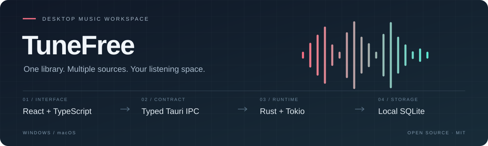
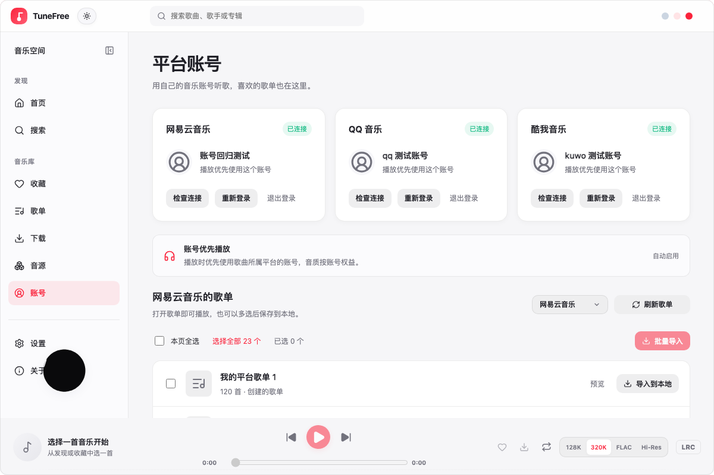
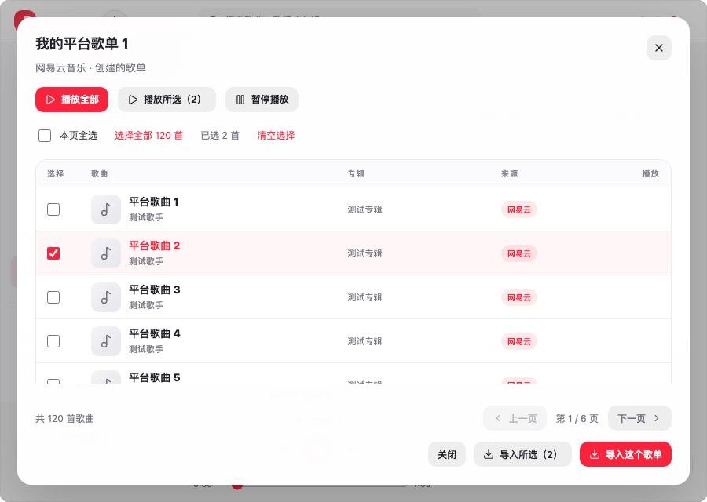
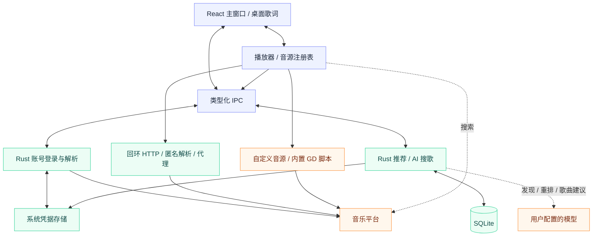

<div align="center">


# TuneFree Desktop

连接音乐账号，聚合多平台搜索，在自己的曲库与播放队列里听歌。

[](https://github.com/alanbulan/TuneFree/releases/latest)
[](https://github.com/alanbulan/TuneFree/actions/workflows/ci.yml)
[](https://github.com/alanbulan/TuneFree/actions/workflows/release.yml)
[](./LICENSE)
[](https://linux.do/)

[下载安装](./INSTALL_GUIDE.md) · [桌面体验](#桌面体验) · [技术架构](#技术架构) · [开发与验证](#开发与验证) · [发布流程](./RELEASE.md)



</div>

TuneFree Desktop 是 TuneFree 的 Tauri v2 桌面客户端，主开发分支为 `tauri`。界面由 React 与 TypeScript 构建，Rust 承担账号登录与解析、系统集成、本地代理和推荐数据管理；应用复用系统 WebView。

当前桌面正式版为 [v1.1.46](https://github.com/alanbulan/TuneFree/releases/tag/v1.1.46)（2026-11-15）。本页介绍桌面端；仓库中历史移动端版本使用独立版本标签。

## 下载安装

| 平台 | 安装资产 | 说明 |
| --- | --- | --- |
| Windows x64 | `TuneFree_{version}_x64-setup.exe` | NSIS 安装向导 |
| macOS 11+ · Apple Silicon / Intel | `TuneFree_{version}_universal.dmg` | 同一通用安装包覆盖两种架构 |

从 [GitHub Releases](https://github.com/alanbulan/TuneFree/releases/latest) 下载。`.sig`、`.app.tar.gz` 和 `latest.json` 用于自动更新，普通安装只需下载对应安装包。

Mac 包采用 ad-hoc 本地签名，尚未进行 Apple Developer ID 签名与公证，首次打开方式见[安装说明](./INSTALL_GUIDE.md)。Linux 暂无官方安装包。

## 桌面体验

| 音乐工作空间 | 桌面集成 | 智能发现 |
| --- | --- | --- |
| 聚合搜索、平台账号播放、队列与收藏 | 独立透明桌面歌词、逐行 / 逐字高亮 | 基于曲库与播放反馈的本地推荐 |
| 歌单预览、选曲导入、下载与离线播放 | 歌词锁定、置顶、位置与尺寸记忆 | 用户配置的 OpenAI 兼容模型发现与重排 |
| 全屏播放器、主题、曲库 JSON 备份 | 托盘控制、关闭行为设置、签名自动更新 | 按心情或场景描述生成 AI 歌单 |

### 账号与歌单

在音乐库「账号」中连接网易云、QQ 音乐、酷我音乐，三家各保存一个账号，可同时使用。登录在平台官网窗口完成。播放器先读取已有离线文件，再使用歌曲所属平台的本人账号取播放地址；账号解析成功时，无需音乐脚本提供播放链接。可播放范围和实际音质遵循平台对该账号的授权。

- 个人歌单每页 10 个，支持跨页多选、批量导入、停止和失败重试。
- 歌单预览每页 20 首，可收藏、跨页选曲、导入所选或导入整份歌单。
- 「播放所选」只将所选歌曲按原顺序带入队列；点歌或「播放全部」将完整歌单带入当前队列，从所点歌曲或第一首开始播放。
- 导入结果是本地副本，后续可按本地歌单方式管理；不向平台回写或自动双向同步。

会话由 Rust 保存到系统凭据存储：Windows 使用凭据管理器，macOS 将三平台会话与模型密钥合并到一个钥匙串项，并共享进程内读取。系统授权仍由用户处理，跨版本访问提示受应用签名与系统规则影响。协议、界面与本人账号验收范围见[平台账号记录](./docs/platform-accounts-plan.md)。

<details>
<summary><strong>账号页与歌曲选择预览</strong></summary>

以下为生产前端配合测试 IPC 生成的界面，账号与曲目使用模拟数据。





</details>

### 搜索、曲库与音源

「全部音源」聚合已注册且可用的平台，默认包含网易云、QQ 音乐、酷我、酷狗、咪咕与 JOOX，也可指定单个平台。某个源失败时保留其他结果；连续失败的通道会暂时停止请求。各平台的搜索与播放能力见[音源表](#音源与开源许可)。

本地歌单支持新建、整理与歌曲排序，也可粘贴网易云 / QQ / 酷我的歌单链接或 ID 导入。设置中的 JSON 备份包含收藏和歌单，导入前先校验并预览，支持合并或覆盖。下载文件保存在磁盘，可选择下载目录；已有文件优先用于离线播放。

音源管理支持本地文件、多文件拖放和 HTTPS 链接导入，以及排序、启停、删除、检测、重载、检查更新与近期诊断。自定义音源通过 LX 兼容 Worker 沙箱运行，具体兼容性以脚本使用的能力为准。

### 推荐与音乐伙伴

本地推荐根据曲库与播放反馈生成，不需要云端 API Key。AI 精选与首页 AI 搜歌共用用户配置的 OpenAI 兼容模型：在设置中填写 API 根地址、API Key，获取模型列表并选择模型，启用后保存，可测试连接。默认超时 60 秒，最长可设为 180 秒。

AI 搜歌由模型提供歌名、歌手和简短理由，再通过统一平台注册表查找真实曲目，取得平台 ID、封面与元数据后进入正常播放解析。旧版 Embeat 歌曲仍保留兼容解析；当前 AI 搜歌使用上述模型配置。

**Bloub 音乐伙伴**随播放与推荐状态变化，支持点击、拖动和右键动作面板。项目复用上游 TypeScript 动画核心并维护 React 适配层，来源和许可见 [vendor/bloub](./vendor/bloub/README.md)。

## 技术栈


| 层级 | 技术 | 职责与实现入口 |
| --- | --- | --- |
| 界面与交互 | React 19、TypeScript 7、Framer Motion | 主窗口、功能页面、播放器与动画；[src/desktop](./src/desktop) |
| 播放与服务编排 | TypeScript、浏览器音频能力 | 播放状态、音源服务、解析与歌词；[src/core](./src/core) |
| 原生契约 | Tauri v2、类型化 IPC | 命令、事件、错误码的统一入口；[src/core/ipc](./src/core/ipc) |
| 桌面宿主与账号 | Rust、Tauri 插件、系统凭据存储 | 登录会话、账号解析、窗口、下载、托盘与更新；[src-tauri/src/app](./src-tauri/src/app) |
| 本地网络 | Axum、Tokio、Reqwest | 回环 HTTP 服务、匿名解析与代理；[server.rs](./src-tauri/src/server.rs)、[api](./src-tauri/src/api) |
| 推荐与存储 | SQLite、rusqlite、OpenAI 兼容协议 | 曲库、事件、反馈、候选召回与模型编排；[recommendation](./src-tauri/src/recommendation) |
| 构建与验证 | Vite、Vitest、Oxlint、Cargo、GitHub Actions | 前端打包、契约检查、测试、原生构建和发布 |

精确版本以 [package-lock.json](./package-lock.json)、[Cargo.lock](./src-tauri/Cargo.lock) 和 [rust-toolchain.toml](./rust-toolchain.toml) 为准。应用关于页在构建时读取这些文件，避免手工维护版本信息。

## 技术架构



### 关键链路

| 链路 | 数据经过哪里 | 约束 |
| --- | --- | --- |
| 搜索 | 关键词 → 注册表中的平台搜索 → 真实曲目与元数据 | 桌面聚合搜索自动包含可用的扩展平台，支持指定音源 |
| 播放 | 已有离线文件 → 所属平台账号 → 用户音源 / 内置匿名解析 → 同曲匹配恢复 | 自定义脚本按用户排序尝试；账号成功后不再请求脚本播放链接 |
| 个性化推荐 | 曲库与行为 → SQLite → 召回与排序 → 可选模型发现 / 重排 → 反馈回写 | 数据和任务状态由 Rust 本地服务管理，云端能力需用户配置 |
| AI 搜歌 | 场景描述 → 已配置模型的歌曲建议 → 平台搜索匹配 → 正常播放解析 | 模型不生成播放 ID 或音频地址，未匹配到真实曲目的建议不进入结果 |

### 工程边界

- **IPC 单一入口**：前端通过 `src/core/ipc` 调用 Tauri。CI 对 TypeScript 命令表与 Rust 注册表做双向比对，阻止契约漂移。
- **本地服务按启动隔离**：仅绑定 `127.0.0.1` 随机端口，每次启动生成访问令牌；前端通过 `get_local_server_info` 获取连接信息。受保护路由检查令牌，代理受来源与主机规则约束。
- **运行时地址不持久化**：前端不硬编码端口，也不保存已解析的本地服务 URL，避免下次启动使用失效地址。
- **持久化与凭据分离**：收藏与本地歌单保存歌曲元数据，推荐数据进入 SQLite；账号会话与模型密钥使用系统凭据存储，不进入曲库备份，前端只收到账号摘要和密钥存在状态。
- **模型请求范围**：AI 发现与重排会发送候选曲目元数据和画像摘要，最近少量事件摘要由独立设置控制；AI 搜歌发送本次场景描述与脱敏画像摘要。
- **更新先验签**：Tauri updater 验证更新签名后安装；发布流程核对各平台资产与清单，再公开新版本。

<details>
<summary><strong>源码导航</strong></summary>

```text
app/                          主窗口共享样式与独立桌面歌词模块
desktop-lyric/                桌面歌词独立 HTML 入口
src/core/                     播放器、状态、音源服务、解析与通用工具
src/core/ipc/                 Tauri 命令、事件、错误码与类型契约
src/desktop/                  主窗口、功能页面与桌面交互
src-tauri/src/app/            原生命令、窗口、下载与更新编排
  platform_accounts/         三平台登录、资料、歌单与账号播放协议
src-tauri/src/api/            匿名解析与代理边界
src-tauri/src/credentials/    macOS 共享钥匙串仓库与旧凭据迁移
src-tauri/src/recommendation/ 本地推荐、模型编排与 SQLite 持久化
  migrations/                按日期与顺序拆分、编译嵌入的 SQL
vendor/bloub/                 上游动画核心、版本来源与许可证
e2e/                          生产前端浏览器回归
scripts/                      架构、IPC、发布和运行验收脚本
.github/workflows/            共享质量门禁与跨平台发布
```

</details>

目录职责与新增模块约定见[代码与目录约定](./docs/code-structure.md)；最新测量方法、优化与边界见[桌面性能检测](./docs/performance-review-2026-11-15.md)。

**v1.1.46** 调整音乐伙伴、频谱与桌面歌词的更新频率，减少持续播放和空闲时的绘制工作；推荐数据库迁移按日期和顺序拆成独立 SQL 文件，保留旧库升级行为。详情见[版本说明](./docs/releases/v1.1.46.md)。

## 开发与验证

v1.1.46 的 CI 环境使用 Node.js 26.13.0、npm 12.2.1、Rust 1.99.1（`rust-toolchain.toml` 固定；最低 Rust 版本为 1.95）。Windows 需要 Visual Studio C++ Build Tools 与 WebView2；macOS 需要 Xcode Command Line Tools。沿用已有开发环境与项目锁文件，具体安装和构建见[安装指南](./INSTALL_GUIDE.md#开发环境)。

```sh
npm ci
npm run tauri dev
```

Vite 开发服务监听 `127.0.0.1:3101`。单独运行 `npm run dev` 只启动前端资源服务，账号、系统凭据、磁盘下载与推荐能力需要 Tauri 后端。运行浏览器回归前先结束开发服务，测试会独占同一端口。

<details>
<summary><strong>与 CI 对齐的验证命令</strong></summary>

```sh
npm run version:check
npm run lint
npm run typecheck
npm run architecture:check
npm run test:coverage
npx playwright install chromium
npm run test:e2e
npm run audit
cargo fmt --manifest-path src-tauri/Cargo.toml --all -- --check
cargo clippy --manifest-path src-tauri/Cargo.toml --locked --all-targets --all-features -- -D warnings
cargo test --manifest-path src-tauri/Cargo.toml --locked --test app_tests -- --include-ignored
npx tauri build --no-bundle
npm run smoke
```

`version:check` 以 dry-run 核对版本文件并预览下次升级，不修改版本。浏览器回归会先构建生产资源，再检查长歌单滚动、返回导航、账号页和选曲播放 / 导入。原生质量门禁在 Windows 与 macOS 上分别执行，两端都会实际构建并启动应用；完整流程见 [validate.yml](./.github/workflows/validate.yml)。macOS 发布时另外构建通用二进制并验证两种 CPU 架构。

Clippy 的严格规则固化在 `Cargo.toml`。Tauri 的 `beforeBuildCommand` 已包含前端构建，不必额外重复 `npm run build`。真实音源核验：

```sh
npm run api:verify:gd
npm run api:verify:gd -- --source joox --details
```

</details>

## 工程质量

质量指标以仓库配置和可追溯的 Actions 运行记录为依据。

| 指标 | 当前门禁 | 证据 |
| --- | --- | --- |
| 前端行覆盖率 | **100% 阈值**，按配置纳入业务源码 | [Vitest 配置](./vitest.config.ts)；CI 上传 `coverage-lcov` |
| 静态检查 | Oxlint 零告警、TypeScript 类型检查、Rust fmt / Clippy | [共享 Validate 工作流](./.github/workflows/validate.yml) |
| 架构一致性 | 分层导入、文件规模、样式预算、IPC 双向契约检查 | [架构守卫](./scripts/check-architecture.mjs)、[IPC 守卫](./scripts/check-ipc-contract.mjs) |
| 依赖审计 | npm 高危及以上漏洞阻断流水线 | [package.json](./package.json) 中的 `audit` |
| 启动验收 | 真正运行程序，等待界面挂载并请求本地健康检查 | [smoke-test.mjs](./scripts/smoke-test.mjs) |
| 发布完整性 | Windows / macOS 安装与更新资产、签名、版本和平台 URL 检查 | [publish-release.mjs](./scripts/publish-release.mjs) |

覆盖率阈值不代表外部音乐源、付费模型或所有平台功能均已验收。启动测试使用隔离目录，并禁用云端模型与自动更新；真实 GD Music 接口通过 `npm run api:verify:gd` 单独验证。

**v1.1.46 发布验证记录（2026-11-15）**：以下是该版本的结果，后续版本以对应 Actions 记录为准。

| 检查 | 结果 |
| --- | --- |
| 前端测试与行覆盖 | 127 个文件、1,090 项通过；8,846 / 8,846 行，100% |
| 生产浏览器回归 | 17 项通过，含分页、跨页选曲、完整播放队列与导入 |
| 原生 Rust 测试 | Windows 372 项、macOS 320 项通过 |
| IPC 契约 | 47 条命令、11 个数据结构通过双向检查 |
| 构建与启动 | Windows / macOS 构建及隔离启动通过；Mac 通用包双架构核验通过 |

[发布 Actions](https://github.com/alanbulan/TuneFree/actions/runs/43690090336) · [v1.1.46 版本说明](./docs/releases/v1.1.46.md) · [性能测量方法与结果](./docs/performance-review-2026-11-15.md)。本人网易云与 QQ 的账号播放有实测记录；酷我本人登录、会员高音质与 Windows 本人登录的验收边界见[账号记录](./docs/platform-accounts-plan.md#真实账号验收)。

## 构建与发布


构建阶段的资产暂存草稿，Windows 与 macOS 串行上传以保留 `latest.json` 的所有平台条目。Mac 构建另外验证通用二进制的两种架构、真实启动和原生 Rust 检查；全部通过才上传。新版本资产齐全后自动公开，旧版本不会覆盖更高版本的 `latest`。

已公开版本可通过 `workflow_dispatch` 补发 Mac 包：版本号必须一致，已有 Mac 资产会阻止覆盖，Windows 包和原标签保持不变。操作与签名说明见 [RELEASE.md](./RELEASE.md)。

## 音源与开源许可

| 展示来源 | 搜索 | 播放解析 |
| --- | --- | --- |
| 网易云 | 平台搜索接口 | 本人账号优先，随后用户音源、内置 GD 脚本与匿名原生解析 |
| QQ 音乐 | 平台搜索接口 | 本人账号优先，使用官方 track-info / Vkey 协议；随后用户音源与匿名原生解析 |
| 酷我音乐 | 平台搜索接口 | 本人账号优先，使用官网会话解析；随后用户音源与匿名原生解析 |
| 酷狗 | 平台搜索接口 | 同平台直接解析需覆盖酷狗的自定义脚本；失败可尝试同曲恢复 |
| 咪咕 | 平台搜索接口 | 同平台直接解析需覆盖咪咕的自定义脚本；失败可尝试同曲恢复 |
| JOOX | 内置 GD 脚本调用公开 API | 内置 GD 当前提供搜索、歌词和封面，播放使用可用自定义源或同曲恢复 |

平台能力来自统一注册表，搜索成功不等于拥有该平台的播放授权；已有离线文件均优先播放。GD 搜索受其公开接口频率限制，内置 GD 当前未声明 QQ 或 Bilibili 通道。

项目自有源码采用 [MIT License](./LICENSE)。平台账号协议改编包含 MIT 与 Apache-2.0 组件，固定提交、修改说明与许可副本见[平台账号开源参考](./docs/platform-account-references.md)。Bloub 动画核心来自 [jeremy-prt/bloub](https://github.com/jeremy-prt/bloub)，沿用其 MIT 许可；本项目维护 React 适配层，上游没有官方 React 组件。

音乐内容及元数据来自第三方服务，本仓库不托管音频资源。GD Music API 由 **GD音乐台（[music.gdstudio.xyz](https://music.gdstudio.xyz/)）** 提供，使用时须遵守其 CC BY-NC 4.0 与非商业使用要求。第三方内容的版权、可用性与使用限制以对应服务条款为准。

## 社区与认可

[](https://linux.do/)
[](https://github.com/alanbulan/TuneFree/issues)
[](https://github.com/alanbulan/TuneFree/graphs/contributors)

**本开源项目已链接并认可 [LINUX DO](https://linux.do/) 社区。** 欢迎围绕桌面音乐体验、技术实现与开源协作交流。

| 公开标识 | 含义 | 核验入口 |
| --- | --- | --- |
| LINUX DO 社区认可徽标 | TuneFree 主动链接并认可社区；不代表社区对项目的官方认证或安全背书 | [LINUX DO](https://linux.do/)；本节项目声明 |
| 维护与贡献身份 | 以公开提交、代码评审与贡献记录为准 | [Commits](https://github.com/alanbulan/TuneFree/commits/tauri)、[Contributors](https://github.com/alanbulan/TuneFree/graphs/contributors) |
| 构建与发布状态 | 徽标链接到实际流水线；安装包来自本仓库 Release | [Actions](https://github.com/alanbulan/TuneFree/actions)、[Releases](https://github.com/alanbulan/TuneFree/releases) |

社区关联的表述与徽标形式参考 [InkOS](https://github.com/Narcooo/inkos#readme)、[mediary-scout](https://github.com/fancydirty/mediary-scout#readme) 和 [LinuxDo-Badges](https://github.com/postyizhan/LinuxDo-Badges)。问题反馈请使用 [Issues](https://github.com/alanbulan/TuneFree/issues)，附上版本、操作系统、复现步骤与脱敏日志；代码改进通过 Pull Request 提交，并通过仓库现有检查。

## Star History

[](https://github.com/alanbulan/TuneFree/stargazers)
[](https://github.com/alanbulan/TuneFree/forks)
[](https://github.com/alanbulan/TuneFree/releases)
[](https://github.com/alanbulan/TuneFree/commits/tauri)

<picture>
  <source media="(prefers-color-scheme: dark)" srcset="https://api.star-history.com/svg?repos=alanbulan/TuneFree&type=Date&theme=dark" />
  <source media="(prefers-color-scheme: light)" srcset="https://api.star-history.com/svg?repos=alanbulan/TuneFree&type=Date" />
  
</picture>

曲线由 [Star History](https://www.star-history.com/#alanbulan/TuneFree&Date) 根据 GitHub 数据生成，展示关注度变化；Stars、Forks 和下载量均为整个仓库的统计，包含历史移动端版本，不等同于桌面端活跃用户或性能指标。
