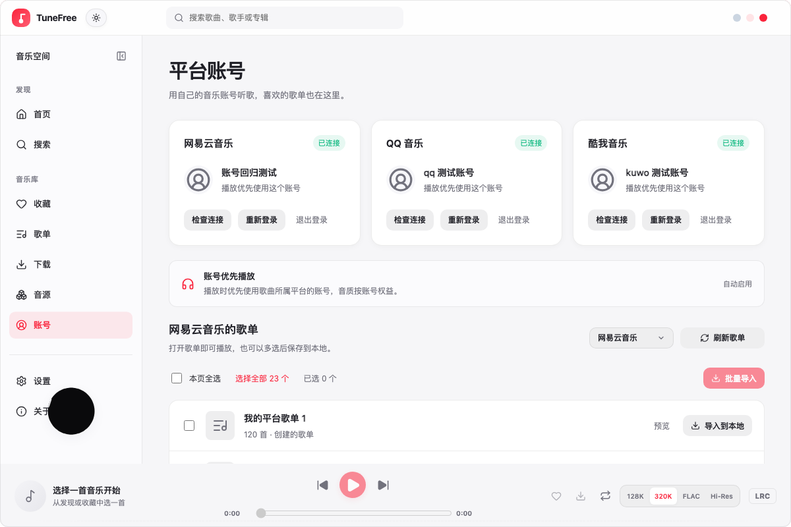
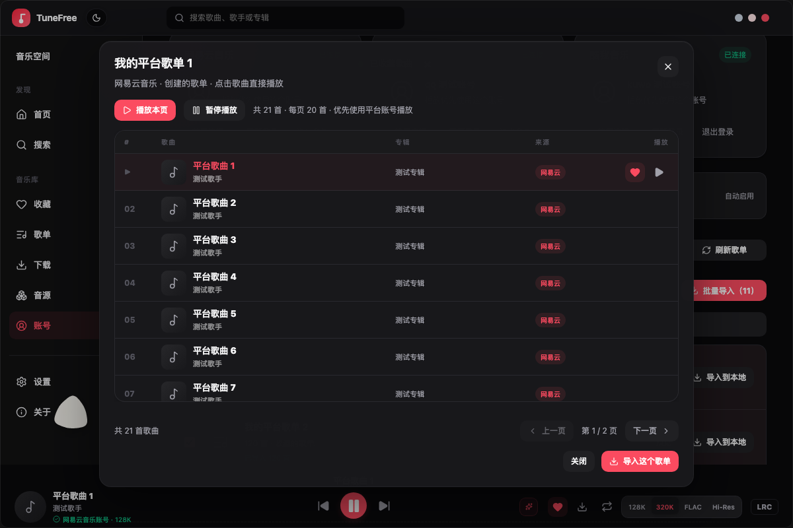
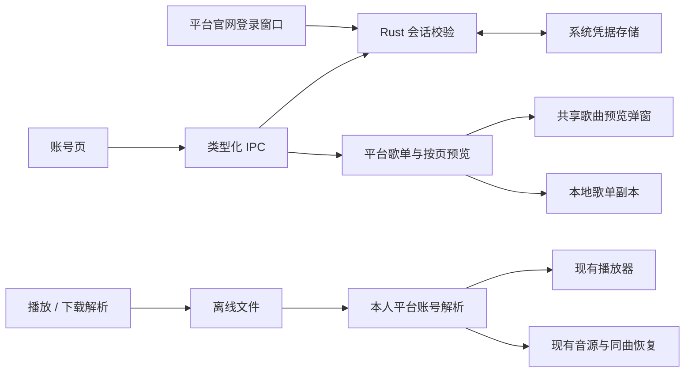

# 桌面端平台账号：开发计划与界面设计

更新：2026-11-15。本轮版本：v1.1.45，基于 v1.1.44 (`d0dc1a4`)；按持有人授权通过现有 GitHub Actions 流程发布。初始功能基线为 v1.1.43 (`6adef260`)。

[本轮 Issue #13](https://github.com/alanbulan/TuneFree/issues/13) · [初始 Issue #11](https://github.com/alanbulan/TuneFree/issues/11) · [初始 PR #12](https://github.com/alanbulan/TuneFree/pull/12) · 发布分支 `tauri`。

连接网易云音乐、QQ 音乐、酷我音乐后，播放对应平台的歌曲默认先由本人账号取链接，再交给现有播放器。账号也提供个人歌单浏览、直接点歌和本地导入；使用这些功能无需安装音乐脚本。可播放范围与音质遵循平台给该账号的完整歌曲授权。

## 交付行为

- 三个平台各连接一个账号，可同时保存和使用。官方独立窗口提供扫码或其他登录方式，完成后自动检测，也可以手动确认连接。
- 播放顺序：已有离线文件 → 歌曲所属平台账号 → 现有音源与匿名解析 → 现有同曲匹配。账号成功时不再请求脚本播放链接；账号失效、无完整播放权限或链接播放失败时，现有恢复链路可以继续。
- 播放器在音频开始播放后显示「平台账号 · 实际音质」。登录、退出、重新登录、账号失效和音源变动使缓存失效；切换队列、暂停恢复、单曲循环也检查当前账号代数。
- 个人歌单每页显示 10 个，支持本页全选、选择全部、跨页保留选择和批量导入。只有当前页的歌单行进入 DOM，封面延迟加载。
- 点击歌单打开预览弹窗，每页读取并渲染 20 首歌曲。复用现有 `SongTable`，支持跨页多选、本页 / 全部选择、清空、播放所选、导入所选、暂停 / 继续和收藏。
- 播放全部或点击某首歌曲时，按需读取完整歌单元数据，将完整歌单替换进当前播放队列，从第一首或点击的歌曲开始；播放所选只使用选中歌曲，按歌单原顺序排列。完整数据仅缓存在当前弹窗，展示仍分页，读取可取消。
- 批量导入逐份完成，显示进度与每份结果，可停止并重试失败项。已经成功保存的副本保留；停止后的迟到响应不会写入曲库。
- 提供检查连接、重新登录、取消登录、退出与读取失败重试。重复导入同名歌单前确认，本地保存失败有明确结果；选择性导入失败重试保留原选择。

不提供平台歌单回写、双向同步或后台自动同步。曲库保存歌曲元数据和 QQ file MID，不保存授权播放 URL 或会话。

## 桌面界面

沿用项目主题变量、系统字体、卡片、按钮、歌曲表格和自定义选择器，支持浅色 / 深色及 900 × 640 的桌面最小尺寸。

| 区域 | 展示与交互 |
| --- | --- |
| 页面标题 | 「平台账号」，简短说明用本人账号听歌和浏览个人歌单；不展示实现完成说明卡 |
| 三平台卡片 | 平台、昵称 / 头像、状态、连接检查与重新登录、退出 |
| 歌单工具栏 | 统一 `CustomSelect compact`；平台切换与刷新均为 128 × 32px |
| 选择栏 | 统一文本按钮和复选框；已选数量与批量导入主操作 |
| 歌单行 | 复选框、44px 封面、名称与数量、预览及导入；无浏览器默认深色边框 |
| 分页 | 共享 `LibraryPagination`，独立歌单 / 歌曲页码 |
| 预览弹窗 | 共享 `DesktopModal` / `SongTable`，播放全部 / 所选、跨页歌曲选择、20 首列表、分页、导入整份 / 所选；最小窗口下保留完整底部操作 |
| 底部播放器 | 保持现有布局，成功播放后显示账号和实际音质 |

弹窗使用 portal，背景 inert，焦点闭环，Escape 关闭并恢复打开位置的焦点；弹窗自身有暂停 / 继续操作。导入时先关闭预览，再显示现有同名确认弹窗。歌曲区域独立滚动，页码和底部按钮在 900 × 640 下完整可见。选中背景、悬停、错误、成功状态复用现有颜色变量。

以下截图由实际生产前端加测试 IPC 生成，账号和歌曲均为模拟数据，用于界面评审。

[浅色预览](assets/platform-accounts/preview-light.png) · [深色账号页](assets/platform-accounts/implementation-dark.png) · [跨页歌单选择](assets/platform-accounts/selection-light.png) · [歌曲多选](assets/platform-accounts/song-selection-light.png) · [深色歌曲多选](assets/platform-accounts/song-selection-dark.png)。

早期两平台导入原型保留于 `assets/platform-accounts/connected.png` 等文件；本页新截图与上述交付行为是当前设计。

## 结构与协议

- 登录窗口使用临时非持久化 WebView。QQ / 微信弹窗保留官网 opener 和 Cookie 环境；导航只允许精确平台登录主机，酷我仍使用 HTTP 的指定回调路径升级为 HTTPS。
- macOS 统一钥匙串项保存三平台会话与模型密钥，Windows 沿用现有凭据管理器；写入后读回验证，失败执行回滚。进程缓存合并读取与授权失败，旧记录按需迁移，前端、外部脚本和曲库备份只收到摘要与歌曲，不收到 Cookie。
- 原生账号请求使用固定 HTTPS 端点、关闭重定向、限制响应大小。授权 URL 校验平台 CDN、协议、端口，不将 Cookie 发给音频 CDN。
- 网易使用 EAPI `song_url_v1` 的 `standard / exhigh / lossless / hires`；排除 `freeTrialInfo` 和未授权歌曲。
- QQ 使用带 `zzc` 签名的 `musics.fcg`。先取 `CgiGetTrackInfo` 的真实 media MID 与文件大小，再请求 `UrlGetVkey`，按实际有权限的候选音质返回。
- 酷我使用独立 `checkLogin` 校验 uid / sid，官网 `playUrl` 携会话与当前 Secret / csrf。音质根据响应格式与码率确认；缺少码率的官网 MP3 按 128K 档处理，不能仅凭请求档位显示 FLAC / 320K。
- 账号解析网络总预算 12 秒；前端包含系统凭据 / IPC 等待的总预算 14 秒，超时继续现有解析恢复。请求返回前检查会话 revision，退出 / 切换后的旧 URL 不会成为当前缓存。
- 网络侧与界面侧分页分开：网易 / QQ 分页完整读取账号列表；酷我列表接口忽略 pn / rn，限制完整列表大小并在界面按 10 个分页。预览只按页取得曲目；整份导入检查总量、顺序和缺失批次。

固定提交、源码位置、改编内容与许可证见 [开源参考与许可](platform-account-references.md)。

## 开发顺序与状态

1. 已以仓库持有人身份创建 Issue，记录桌面范围与验收条件。
2. 已整理账号 / 预览 / 批量操作设计并落实到项目共享 UI。
3. 已接入三平台原生登录、Cookie 会话、资料与歌单读取，以及系统凭据。
4. 已接入账号优先播放、实际来源、音质返回和账号变更后的缓存失效。
5. 已完成预览点歌 / 收藏、分页、歌曲多选、完整队列与批量导入的错误和停止流程。
6. v1.1.44 已通过自动化检查及隔离原生启动；2026-11-15 持有人在开发模式反馈「可以了，没问题了」。后续反馈作为当前修复继续验证。
7. v1.1.44 已发布；本轮按新增反馈修复头像、凭据读取、QQ 官方解析与歌曲选择。持有人再次授权发布，统一版本至 1.1.45，通过 PR CI 后合入 `tauri`，推送 `v1.1.45` 标签执行共享验证、Windows / macOS 构建、更新签名、资产检查和自动公开。

## v1.1.44 发布时验证证据

| 检查 | 当前结果 |
| --- | --- |
| TypeScript / Oxlint / 分层 | 通过；46 条 IPC 命令，11 个数据结构契约 |
| 前端测试 | 127 文件 / 1,075 项通过；行覆盖率 100%（8,737 / 8,737） |
| 浏览器回归 | 15 项通过；含三平台模拟预览实播、暂停 / 继续、收藏、10 个 / 页、跨页批量、同尺寸与零默认边框 |
| Rust | fmt、严格 Clippy 通过；291 项通过，含三平台隔离系统凭据读写删除 |
| 原生 | macOS release 构建与隔离 smoke 通过，确认业务外壳挂载、IPC 与回环服务 |

隐藏 WKWebView 暂停动画帧曾造成 smoke 超时。前端现对已挂载的业务外壳进行显式检查，隐藏时通过事件循环通知原生；可见时仍等待动画帧，原生仍检查 HTTP 健康与本次运行标记。回归覆盖隐藏、未挂载和失败通知情形。

平台测试使用隔离 HTTPS 响应；浏览器播放测试使用确定的 WAV 数据和测试 IPC。这些检查不替代本人账号实际授权与远端音频实播。

## 真实账号验收

2026-11-15，开发版重新运行并显示账号页后，持有人反馈「可以了，没问题了」，明确授权升级版本并发版，开发模式验收通过。已直接观察到网易云、QQ 的保存账号状态、网易云 18 份个人歌单，播放器显示网易云账号来源；此前也读取过 QQ 喜欢的歌曲列表，QQ 签名 track-info 端点的匿名真实请求返回 `code=0`。

持有人未逐项提供三平台、会员音质、会话撤销与 Windows WebView2 的实测记录，因此这些项目不写成已由工具分别验证。自动化结果与持有人验收反馈分别保留。

前期 macOS 钥匙串等待已不再阻塞本次可见账号页，系统权限始终由持有人处理；没有修改系统凭据权限或改为明文保存。

## 账号头像修复（2026-11-15）

v1.1.44 反馈 QQ 登录与昵称正常，头像使用占位。登录校验响应并不保证头像字段，补查官网基础资料的 `map_userinfo[当前 ID].headurl`，必要时按已确认的加密身份查主页 `Info.BaseInfo.Avatar`。酷我头像依然按官网 Cookie 协议读取 `pic3`，修复无效主字段遮挡有效 `pic` 的回退问题。详细固定来源、许可与真实公共接口证据见 [开源参考](platform-account-references.md)。

旧版保存的缺失头像在账号页加载后由原生后台补查一次；检查连接和自动补查都验证写回系统凭据，保留会话与原连接时间。头像网络失败保留原图，退出登录或账号切换会取消旧结果。图片加载失败显示统一占位，点击检查连接可重新请求相同地址。

新增回归覆盖原生登录确认 → QQ 资料请求 → 头像 HTTPS 归一化 → 保存 / 恢复，以及 QQ / 酷我图片在浏览器中的解码加载；测试使用公开协议结构与虚构资料，不公开本人昵称或头像。修复通过新版本 v1.1.45 交付。

## 当前修复：头像、凭据读取与 QQ 原生播放

- QQ 登录校验响应可能没有头像，补查基础资料或本人加密身份的主页头像，保存后无需再次扫码。本机已观察到保存账号的 QQ 头像正常显示。
- 酷我每个 `pic3 / pic` 候选都先解码并验证，避免无效主字段遮住有效备用头像。独立 `checkLogin`、Secret 和真实音质规则保持；尚无本人酷我账号实测。
- 按持有人反馈移除「账号优先播放 / 自动启用」说明卡片、账号昵称下的重复实现说明及预览中的账号优先说明。仅保留操作、账号状态和实际播放来源。
- QQ Vkey 参数统一使用音乐账号的十进制字符串身份，Cookie 同步为 `uin / qqmusic_uin / qm_keyst / qqmusic_key`，避免浏览器 OAuth 的其他身份混入。按文件大小构造当前 media MID 与既有 media MID + song MID 候选；仅返回 `result=0` 或未提供拒绝码的完整授权。
- 2026-11-15 本人已保存 QQ 账号实播《两只老虎》（儿歌多多、小呱呱乐队）。最终代码的官方 `CgiGetTrackInfo / UrlGetVkey` 返回成功，320K 未授权、128K 授权；播放器时间推进并显示「QQ 音乐账号 · 128K」，该次未进入备用播放解析。受限候选返回 `result=22`、没有 Vkey；返回码不单独视为所有用户的会员结论，会员高音质仍未验收。临时会员探针已移除。

### macOS 启动密码

旧实现为每个平台分别读取 Keychain item，配置展示也读取 AI 密钥；三个平台可以触发多个系统授权。开发和正式产物使用 ad-hoc 签名、没有 TeamIdentifier，重编后 designated requirement 的 cdhash 变化，旧的「始终允许」可能无法匹配新程序。

当前将三平台会话与模型密钥收进一个 `com.alanbulan.tunefree.credentials / application-vault-v1` item；进程内共享成功、缺失与失败缓存。配置与任务调度只查 Keychain metadata，不解密；取消授权后自动播放、刷新与自动模型目录保持失败，显式重试才清除失败缓存。

初次按需批量迁移旧加密记录，原子写入并真实读回验证，旧平台记录保留给正在运行的 v1.1.44。退出会话有 resolved tombstone 并清理对应旧记录，防止复活。空锁文件协调不同进程的 vault 更新，不保存秘密；前端、日志和备份均不包含 vault 内容。

本机第一次迁移观察到旧网易、QQ 各读取一次，统一 item 初读与写后校验共两次。**同一二进制重启** SHA-256 未变化，统一 item 读取一次、旧迁移零次、账号正常恢复。此证据证明消除了本次分平台的重复读取；跨版本永久免授权仍需稳定 Apple Developer ID 签名，当前没有有效签名身份，也未修改系统访问权限。

### 歌曲选择与完整播放队列

预览将 `source:id` 与歌曲原始索引保存在选择 Map 中；翻页保留选择，播放所选按原顺序排列。点击复选框或使用键盘不会触发行播放。点击行和播放全部按需完整读取一次元数据，再调用既有 `playQueue(complete, start)`；不写本地歌单，不保存授权 URL。取消读取、关闭弹窗、退出或切换账号后，旧响应不能修改播放队列、选择或曲库。

导入所选直接使用选中的元数据，先关闭预览，再复用现有同名确认和保存逻辑；失败项携原选择重试，不能变成整份导入。浏览器回归使用 120 首歌单，跨页选择第 2 / 21 首后只播放和保存这两首，再从第 21 首点歌验证完整 120 首队列，播放全部回到第一首，后续选择全部只复用一次完整读取。

本人网易歌单也在开发模式观察到：选择两首后队列仅两首，播放全部后完整 11 首进入队列，显示网易账号 320K。验收后已关闭本地开发与 Vite，保留正式应用。

### v1.1.45 验证与发布记录

| 检查 | 本地验证 |
| --- | --- |
| TypeScript / Oxlint / 分层 / IPC | 通过；47 条命令、11 个数据结构 |
| 前端 | 127 文件 / 1,086 项通过，100% 行覆盖率（8,828 / 8,828） |
| 浏览器 | 17 项回归通过；覆盖跨页歌曲选择、选中导入 / 播放、完整队列、最小窗口底部操作 |
| macOS Rust | fmt / 严格 Clippy 通过；318 项通过，包含隔离真实统一凭据迁移、状态读取与退出 |
| 原生 | release 构建与隔离 smoke 通过；升级版本后重新构建和启动核验 |
| 本人账号 | QQ 头像保存 / 重启、官方 128K 实播；网易选曲与完整队列通过 |

发布标签仍重新执行共享 Windows / macOS CI、通用双架构构建启动、安装包更新签名与六项资产检查。[v1.1.45 版本说明](releases/v1.1.45.md)记录本轮范围；具体公开状态以[发布页](https://github.com/alanbulan/TuneFree/releases/tag/v1.1.45)为准。酷我本人账号、会员高音质与 Windows 本人登录不写成实测通过。
