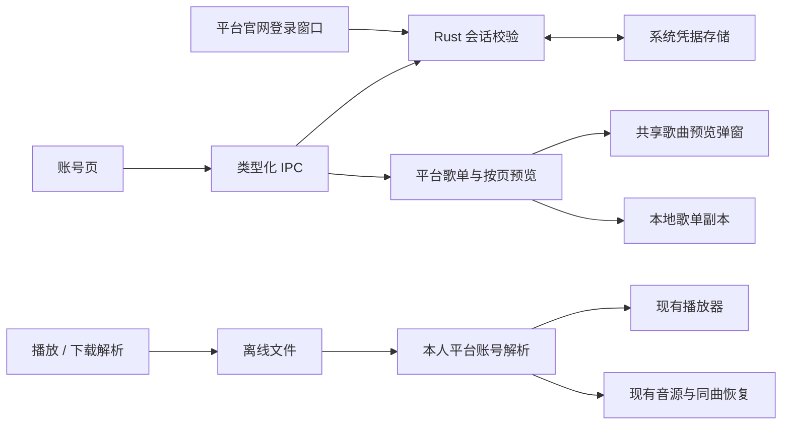

# 桌面端平台账号：开发计划与界面设计

更新：2026-11-15。基线：桌面端 `tauri`，v1.1.43 (`6adef260`)。

[Issue #11](https://github.com/alanbulan/TuneFree/issues/11) · [草稿 PR #12](https://github.com/alanbulan/TuneFree/pull/12) · 分支 `codex/desktop-platform-accounts`。

连接网易云音乐、QQ 音乐、酷我音乐后，播放对应平台的歌曲默认先由本人账号取链接，再交给现有播放器。账号也提供个人歌单浏览、直接点歌和本地导入；使用这些功能无需安装音乐脚本。可播放范围与音质遵循平台给该账号的完整歌曲授权。

## 交付行为

- 三个平台各连接一个账号，可同时保存和使用。官方独立窗口提供扫码或其他登录方式，完成后自动检测，也可以手动确认连接。
- 播放顺序：已有离线文件 → 歌曲所属平台账号 → 现有音源与匿名解析 → 现有同曲匹配。账号成功时不再请求脚本播放链接；账号失效、无完整播放权限或链接播放失败时，现有恢复链路可以继续。
- 播放器在音频开始播放后显示「平台账号 · 实际音质」。登录、退出、重新登录、账号失效和音源变动使缓存失效；切换队列、暂停恢复、单曲循环也检查当前账号代数。
- 个人歌单每页显示 10 个，支持本页全选、选择全部、跨页保留选择和批量导入。只有当前页的歌单行进入 DOM，封面延迟加载。
- 点击歌单打开预览弹窗，每次最多读取 20 首歌曲。复用现有 `SongTable`，支持单曲播放、播放本页、暂停 / 继续、收藏和导入整份歌单。
- 批量导入逐份完成，显示进度与每份结果，可停止并重试失败项。已经成功保存的副本保留；停止后的迟到响应不会写入曲库。
- 提供检查连接、重新登录、取消登录、退出与读取失败重试。重复导入同名歌单前确认，本地保存失败有明确结果。

不提供平台歌单回写、双向同步或后台自动同步。曲库保存歌曲元数据和 QQ file MID，不保存授权播放 URL 或会话。

## 桌面界面

沿用项目主题变量、系统字体、卡片、按钮、歌曲表格和自定义选择器，支持浅色 / 深色及 900 × 640 的桌面最小尺寸。

| 区域 | 展示与交互 |
| --- | --- |
| 页面标题 | 「平台账号」，说明用本人账号听歌和浏览个人歌单 |
| 三平台卡片 | 平台、昵称 / 头像、状态、连接检查与重新登录、退出 |
| 播放说明 | 「账号优先播放 · 自动启用」，说明实际音质按账号权益 |
| 歌单工具栏 | 统一 `CustomSelect compact`；平台切换与刷新均为 128 × 32px |
| 选择栏 | 统一文本按钮和复选框；已选数量与批量导入主操作 |
| 歌单行 | 复选框、44px 封面、名称与数量、预览及导入；无浏览器默认深色边框 |
| 分页 | 共享 `LibraryPagination`，独立歌单 / 歌曲页码 |
| 预览弹窗 | 共享 `DesktopModal` / `SongTable`，标题、播放操作、20 首列表、分页、导入 |
| 底部播放器 | 保持现有布局，成功播放后显示账号和实际音质 |

弹窗使用 portal，背景 inert，焦点闭环，Escape 关闭并恢复打开位置的焦点；弹窗自身有暂停 / 继续操作。选中背景、悬停、错误、成功状态复用现有颜色变量。

以下截图由实际生产前端加测试 IPC 生成，账号和歌曲均为模拟数据，用于界面评审。

[浅色预览](assets/platform-accounts/preview-light.png) · [深色账号页](assets/platform-accounts/implementation-dark.png) · [跨页批量选择](assets/platform-accounts/selection-light.png)。

早期两平台导入原型保留于 `assets/platform-accounts/connected.png` 等文件；本页新截图与上述交付行为是当前设计。

## 结构与协议

- 登录窗口使用临时非持久化 WebView。QQ / 微信弹窗保留官网 opener 和 Cookie 环境；导航只允许精确平台登录主机，酷我仍使用 HTTP 的指定回调路径升级为 HTTPS。
- macOS 钥匙串 / Windows 凭据管理器保存会话，写入后读回验证，失败执行回滚。前端、外部脚本和曲库备份只收到摘要与歌曲，不收到 Cookie。
- 原生账号请求使用固定 HTTPS 端点、关闭重定向、限制响应大小。授权 URL 校验平台 CDN、协议、端口，不将 Cookie 发给音频 CDN。
- 网易使用 EAPI `song_url_v1` 的 `standard / exhigh / lossless / hires`；排除 `freeTrialInfo` 和未授权歌曲。
- QQ 使用带 `zzc` 签名的 `musics.fcg`。先取 `CgiGetTrackInfo` 的真实 media MID 与文件大小，再请求 `UrlGetVkey`，按实际有权限的候选音质返回。
- 酷我使用独立 `checkLogin` 校验 uid / sid，官网 `playUrl` 携会话与当前 Secret / csrf。音质根据响应格式与码率确认；缺少码率的官网 MP3 按 128K 档处理，不能仅凭请求档位显示 FLAC / 320K。
- 账号解析网络总预算 12 秒；前端包含系统凭据 / IPC 等待的总预算 14 秒，超时继续现有解析恢复。请求返回前检查会话 revision，退出 / 切换后的旧 URL 不会成为当前缓存。
- 网络侧与界面侧分页分开：网易 / QQ 分页完整读取账号列表；酷我列表接口忽略 pn / rn，限制完整列表大小并在界面按 10 个分页。预览只按页取得曲目；整份导入检查总量、顺序和缺失批次。

固定提交、源码位置、改编内容与许可证见 [开源参考与许可](platform-account-references.md)。

## 开发顺序与状态

1. 已以仓库持有人身份创建 Issue，记录桌面范围与验收条件。
2. 已整理账号 / 预览 / 批量操作设计并落实到项目共享 UI。
3. 已接入三平台原生登录、Cookie 会话、资料与歌单读取，以及系统凭据。
4. 已接入账号优先播放、实际来源、音质返回和账号变更后的缓存失效。
5. 已完成预览点歌 / 收藏、分页与批量导入的错误和停止流程。
6. 已通过本机自动化检查及隔离原生启动；真实平台扫码和本人账号实播继续在开发模式验收。
7. 草稿 PR 用于评审与 CI；版本仍为 1.1.43，合并与发布另行决定。

## 验证证据

| 检查 | 当前结果 |
| --- | --- |
| TypeScript / Oxlint / 分层 | 通过；46 条 IPC 命令，11 个数据结构契约 |
| 前端测试 | 127 文件 / 1,075 项通过；行覆盖率 100%（8,737 / 8,737） |
| 浏览器回归 | 15 项通过；含三平台模拟预览实播、暂停 / 继续、收藏、10 个 / 页、跨页批量、同尺寸与零默认边框 |
| Rust | fmt、严格 Clippy 通过；291 项通过，含三平台隔离系统凭据读写删除 |
| 原生 | macOS release 构建与隔离 smoke 通过，确认业务外壳挂载、IPC 与回环服务 |

隐藏 WKWebView 暂停动画帧曾造成 smoke 超时。前端现对已挂载的业务外壳进行显式检查，隐藏时通过事件循环通知原生；可见时仍等待动画帧，原生仍检查 HTTP 健康与本次运行标记。回归覆盖隐藏、未挂载和失败通知情形。

平台测试使用隔离 HTTPS 响应；浏览器播放测试使用确定的 WAV 数据和测试 IPC。这些检查不替代本人账号实际授权与远端音频实播。

## 真实账号验收

已观察到持有人完成网易云、QQ 登录并读取网易云 18 份个人歌单、QQ 喜欢的歌曲列表。QQ 签名 track-info 端点的匿名真实请求返回 `code=0`。完整账号播放协议随后调整，仍需本人账号实播确认。

- [ ] 网易云：预览点歌，播放器显示账号来源，切音质 / 暂停恢复。
- [ ] QQ：官网协议授权后完整回调，当前 Vkey 请求与远端音频实际播放。
- [ ] 酷我：官网登录 / 回调、资料、歌单与远端音频实际播放。
- [ ] 三平台：重启恢复、退出、会话撤销与网络恢复；确认旧会话链接不再复用。
- [ ] Windows：WebView2 登录回调、系统凭据与实播；CI 构建单独记录。

当前开发版已打开账号页，系统凭据读取等待 macOS 钥匙串授权；用户需本人处理系统权限窗口。期间页面显示等待原因，不重复读取或改为明文保存。
