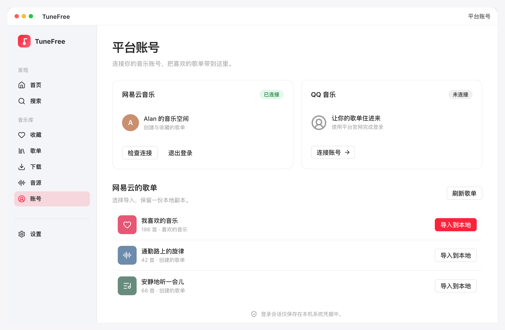
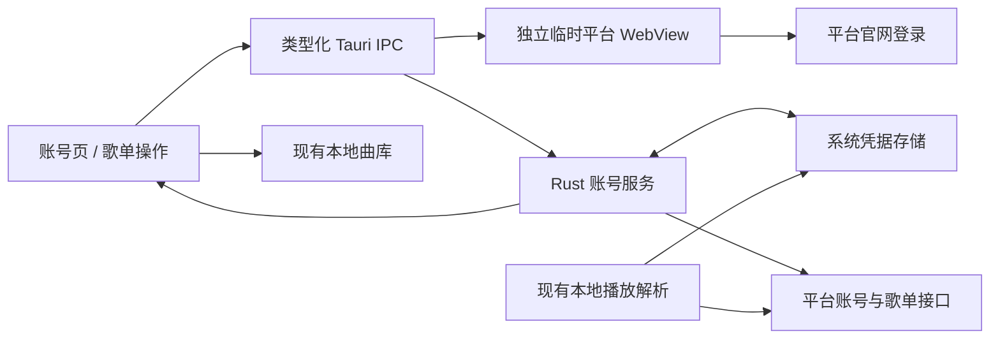
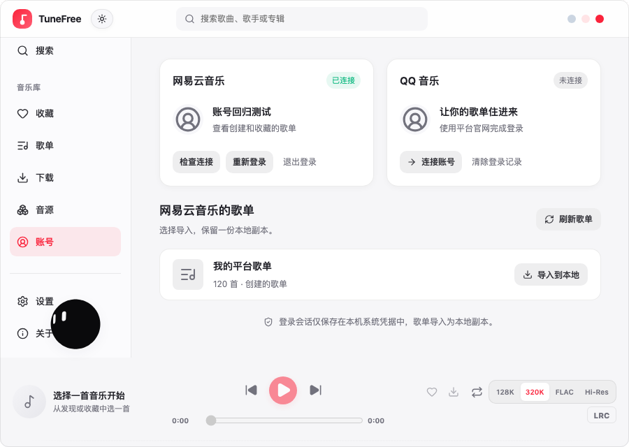

# 桌面端平台账号登录：开发计划与原型

日期：2026-11-14 · 基线：桌面端 `tauri`，v1.1.43 (`6adef260`)

需求：[Issue #11](https://github.com/alanbulan/TuneFree/issues/11) · 开发分支：`codex/desktop-platform-accounts`

状态：首期实现与本机自动化检查已完成，真实账号授权验收待进行；使用草稿 PR 交付。

## 需求

> 佬能否加入一下支持平台音乐账号登录之类的功能啊哈哈(≧ω≦)，因为实在不想用客户端太重了！

在 TuneFree 桌面端连接已有音乐账号，直接查看自己的歌单并在现有轻量播放器中使用。现有应用已经支持匿名聚合搜索、播放和粘贴链接导入歌单，缺少账号会话与个人歌单入口。

## 首期交付

- 网易云音乐、QQ 音乐各连接一个账号，两平台可同时登录。
- 原生独立窗口打开平台官网，使用平台提供的扫码或其他登录方式；TuneFree 不提供密码输入框。完成平台登录后，回到账号页确认连接。
- 原生层校验会话、取得昵称与头像，使用 macOS 钥匙串 / Windows 凭据管理器保存会话。
- 查看账号创建和收藏的歌单，分页读取；选择歌单导入为 TuneFree 本地副本，继续使用现有播放、收藏与下载操作。
- 原生解析在支持的平台请求中使用已保存会话；可播放范围由平台返回的权限决定。
- 提供检查连接、重新登录、取消登录、退出登录；页面卸载后停止轮询。失效会话需要重新登录，网络失败可重试。

首期不提供修改平台歌单、双向同步、后台自动同步或平台密码登录。登录不会承诺获得会员专属资源；平台登录和接口可用性需要真实账号最终验收。

## 界面与原型设计

沿用 TuneFree 的系统字体、浅灰背景、白色卡片、红色主操作以及深色主题。新增音乐库下的「账号」入口，位于「音源」之后。窗口底部播放器始终保留。

| 场景 | 主要内容 | 操作与结果 |
| --- | --- | --- |
| 尚未连接 | 网易云、QQ 两张账号卡；说明连接后可以查看个人歌单 | 「连接账号」打开对应平台官网独立窗口 |
| 登录中 | 当前平台、平台窗口登录提示、等待与错误状态 | 「我已完成登录」校验；「取消」关闭登录窗口；「重新打开」恢复被关闭的窗口 |
| 已连接 | 昵称、头像、连接状态；平台歌单列表 | 「刷新歌单」「重新登录」「退出登录」；歌单卡「导入到本地」 |
| 歌单读取中 | 独立加载状态，防止重复请求 | 成功显示完整列表；失败显示重试入口 |
| 导入完成 | Toast 显示歌单名称与导入曲数 | 导入为本地副本，不回写平台；重复导入前提示 |
| 会话失效 | 标记需要重新登录并说明原因 | 原账号身份不再当作有效会话使用 |
| 浏览器预览 | 可以查看布局与说明 | 登录需要运行 Tauri 桌面应用；原型演示明确标注模拟数据 |

交互原型采用 1040 × 670px 桌面稿，另提供 358px 的局部阅读稿和突出导入操作的展示特写。叙事：连接网易云 → 平台窗口完成登录 → 显示个人歌单 → 导入本地。原型为静态状态加点击交互，无自动循环动画。二维码仅在平台官网生成，演示不制作可被误认为真实授权码的假二维码。

[登录引导](assets/platform-accounts/login.png) · [深色主题](assets/platform-accounts/dark.png) · [窄屏阅读稿](assets/platform-accounts/compact.png) · [导入展示特写](assets/platform-accounts/import-poster.png)

独立视觉复核后修正登录提示裁切、窄屏账号身份缺失和主要操作竞争。完整窗口图供桌面布局评审，另提供特写作为静态展示。截图和设计原型中的账号、数量均为模拟数据。

## 技术方案

- 前端只获得账号摘要、歌单信息和歌曲。会话 Cookie 不返回渲染层，不写 localStorage、曲库备份、日志或 Git。
- 登录窗口使用临时浏览会话，不赋予主窗口的 IPC / 本地文件权限。按精确主机允许登录导航；拒绝无关协议和站点。
- Cookie 在后台线程读取，避免 WebView2 同步回调死锁。读取范围限定为对应音乐平台，登录完成或取消后关闭窗口。
- 平台请求由原生专用客户端直接发往固定 HTTPS 地址，关闭自动重定向，不经过第三方公共代理或自定义音源脚本。
- 凭据保存失败不显示登录成功；凭据存储不可用时显示可操作的错误，不降级为明文文件。
- 歌单分页、曲目分批、去重和顺序恢复在原生层完成；部分批次失败不伪装为完整导入。
- 所有异步页面结果检查生命周期与当前平台，避免切换 / 退出后的旧请求恢复旧账号。
- 关闭窗口会使尚未提交的读取失效；最终保存与取消串行处理。如果保存先完成，取消后的页面重新读取已提交账号。原生计时器在 10 分钟后关闭仍在等待的登录窗口。

现有音源选择保持原逻辑：已保存会话用于本地原生播放解析；自定义音源和第三方聚合解析不会收到该会话。登录不保证优先选中的其他音源自动改用平台账号。

## 实施顺序

1. 创建 GitHub Issue，记录需求、首期范围、验收与开发分支。
2. 完成交互原型及图片，先核对桌面布局、登录提示、歌单入口和深色主题。
3. 实现原生会话、登录窗口、凭据存储、平台资料 / 歌单读取及 IPC 契约。
4. 实现账号页、导航、登录状态、导入和退出操作；复用现有曲库与播放链路。
5. 验证类型、分层契约、单元覆盖率、浏览器交互、Rust fmt / Clippy / 测试和原生构建；记录真实平台验收边界。
6. 提交实现与计划，推送功能分支，创建关联 Issue 的 PR。发布安装包和实际账号授权按后续交付单独进行。

## 验收

- 两平台的未连接、登录中、已连接、失效和请求失败状态均可操作。
- 会话保存、重新读取和删除可验证；取消 / 重启不会遗留活跃登录窗口。
- QQ 与网易云的资料 / 歌单解析有真实格式测试；完整分页与长歌单导入可验证，不静默截断。
- 账号页能完成歌单导入，导入后在现有歌单页可以打开；退出保留已经导入的本地曲库。
- 前端和外部脚本拿不到会话；备份不包含会话；平台请求不泄露 Cookie 到重定向主机。
- 真实扫码确认必须由账号持有人完成；模拟登录测试和原生启动检查不能代替真实平台登录验收。

## 接口依据

- [Tauri WebviewWindow 文档与源码](https://github.com/tauri-apps/tauri/blob/dev/crates/tauri/src/webview/webview_window.rs)：临时 WebView、Cookie 读取及 Windows 同步线程限制。
- [网易云账号接口参考](https://github.com/NeteaseCloudMusicApiEnhanced/api-enhanced/blob/main/module/user_account.js)；[用户歌单接口](https://github.com/NeteaseCloudMusicApiEnhanced/api-enhanced/blob/main/module/user_playlist.js)。
- [QQ 登录资料接口参考](https://github.com/chongya369/qqmusic-api-py/blob/main/qqmusic/apis/user.py)：`music.UserInfo.userInfoServer.GetLoginUserInfo`。

接口格式参考不等于官方开放 OAuth 支持，也不等于本次真实账号已验收。实现以固定平台地址的实测响应和回归测试为准。

## 实现与验证记录

| 层级 | 入口 | 已验证内容 |
| --- | --- | --- |
| 账号页 | `src/desktop/features/library/AccountsView.tsx` 与 `accounts/` | 导入本地、重复提示、失效、取消及切换后的旧响应 |
| 前端契约 | `src/core/services/platformAccounts.ts`、`src/core/ipc` | 八项账号 IPC，摘要中不包含会话 |
| 原生服务 | `src-tauri/src/app/platform_accounts/` | Cookie 过滤、固定地址、分页、曲目分批、凭据写入校验与回滚 |
| 播放解析 | `src-tauri/src/server.rs` 与 `api/` | 本地解析使用可用会话；QQ song MID 与 file MID 分离，认证数据位于 POST 请求体 |

本机最终检查：TypeScript、Oxlint、架构及 44 项 IPC 契约检查通过；119 个前端测试文件、1,038 项测试通过，行覆盖率 100%；13 项完整浏览器回归通过；Rust 276 项测试通过（含隔离系统凭据读写删除）、fmt 与严格 Clippy 通过；macOS release 可执行文件构建及隔离启动检查通过；npm 审计无漏洞。覆盖率的其他指标和外部服务验收不由行覆盖率代替。

HTTPS fixture 测试实际验证两平台多页歌单、225 首长歌单读取与顺序、不完整分页拒绝、QQ 请求体中的会话和 file MID。浏览器账号测试替换 IPC，截图不表示已连接真实账号。

[实际深色账号页布局（测试 IPC）](assets/platform-accounts/implementation-dark.png)

原生临时预览观察到网易云官方个人页、QQ 官方扫码界面能够显示，关闭 / 取消可返回账号页。预览禁止凭据保存；没有主动扫码或提交平台授权。

## 待完成的业务验收

- [ ] 账号持有人完成网易云、QQ 两平台实际登录，验证当前官网 Cookie 和返回资料格式。
- [ ] 连接后读取实际创建 / 收藏歌单、QQ 加密账号标识、喜欢的音乐及长歌单导入。
- [ ] 退出、重启恢复、平台撤销授权及网络失败恢复的真实账号流程。
- [ ] Windows WebView2 和凭据存储的实际运行验收；PR 的 Windows/macOS CI 另外记录。
- [ ] 在原生音源被选用时实播有权限的曲目；会员资源仍以平台返回为准。

完成以上条件后再决定是否转为正式评审、合并和发布。当前版本号仍为 1.1.43，未发布或覆盖安装。
