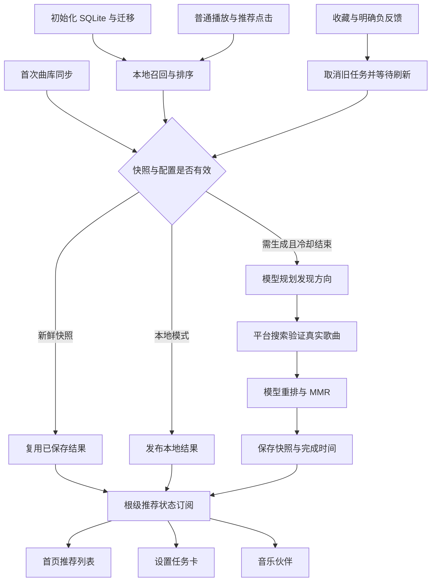

# 推荐任务、歌词与频谱修复

2026-11-16。开发分支 `codex/recommendation-lyrics-reliability`，基于 v1.1.46。本文描述本次改动及验收边界，正式发布以 Releases 为准。

## 推荐链路

设置中的音乐推荐是总开关。本地召回与 AI 精选是同一 Rust 任务的两个阶段，不是两个浏览器 Worker。音源脚本的 Worker 沙箱继续独立运行。

根级 `RecommendationRuntime` 负责首次读取、原生事件和兜底轮询。首页、设置及音乐伙伴读取同一个快照；切换页面或首页标签不会销毁观察者。事件只携带状态，收到任何新任务或终态事件后重新读取完整任务。运行及等待时每 10 秒兜底，空闲时每 60 秒；服务初始化采用有限快速退避。晚到的旧请求、已销毁订阅和清空前的结果不会重新覆盖新状态。

| 原问题 | 本次处理 |
| --- | --- |
| 设置状态停在运行中或等待 | 状态订阅移到应用根级，桌宠也复用；页面读取不改写完成时间 |
| 被取消的任务显示刷新成功 | 区分 `idle / waiting / running / done / error / cancelled / disabled`；结果时间与状态时间分开 |
| 本地任务直接完成后列表不变 | 所有任务事件都补读完整结果，包括新任务直接 `done / local_only` |
| 不感兴趣写两次负反馈 | 可见列表移除不再重复调用 IPC；相同请求与歌曲的 dismiss 重试只写一次事件、画像及反馈 |
| 点击推荐打断正在生成的云任务 | 点击是弱信号；开始播放、30 秒与完成仍由现有媒体事件记录 |
| 本地完成不消费刷新请求 | 本地和云端各自记录时间；本地成功也更新节流时间并清除刷新请求 |
| 启动先生成再被曲库同步取消 | 初次曲库同步前不发起模型请求；同步后才决定是否生成 |
| 有效快照仍反复调用模型 | 按结果期限、配置时间及明确偏好变化复用整轮快照，跳过规划和重排两个模型阶段 |
| 清空、超时与迟到结果竞态 | 统一发布锁与 generation；清空失败回滚数据并发布取消，终态不接受迟到快照写入 |
| 旧模型错误留在设置 | 后台错误随任务状态；连接测试和语境搜歌错误与后台推荐分开，成功清除本轮后台错误 |

自动本地刷新保留 20 秒合并窗口、3 分钟最小间隔，以及 20 条弱信号阈值。云端有独立的 3 分钟请求冷却，启动尝试时间写入 SQLite，重启不会绕过冷却。云端整轮快照沿用用户设置的缓存期限，默认 24 小时；明确偏好变化、配置变化或主动刷新仍可请求更新，已有运行任务复用。读取页面不会发起生成。

新增 `2026-11-16_006_refresh_state.sql`，以版本 6 的独立事务创建调度状态。旧版本 2–5 的 SQL、数据和执行顺序保留，规则见[迁移说明](../src-tauri/src/recommendation/migrations/README.md)。调度、状态、快照有效性和云端管道分别维护在 `service/jobs/`；删除旧首页 watcher。

## 歌词与频谱

歌词获取先尝试原平台 provider；普通 LRC 不提前阻断其他原生逐字来源。跨平台以完整标题、全部歌手、版本和录音时长校验，时长差最多 2 秒。同专辑只用于排序，不放宽录音身份。平台缺少有效同步结果时，匿名查询免费 LRCLIB。未知身份或时长不猜搜索首条记录。

- YRC/QRC 使用原生绝对词时间；KRC 三元词标使用相对行起点，解密复用已有 pako。QRC XML、公共/轨内 offset、重复副歌与负偏移分别处理。
- 原生歌词与跨库请求有超时和取消；缓存不接受取消后的迟到结果。同歌换音质、跨源恢复及回到原平台时保留或清理正确的录音绑定。
- 逐字歌词局部以约 30Hz 读取真实媒体时间。桌面歌词心跳包含倍速和是否实际推进；暂停、缓冲、seek 或心跳失联停止外推。点击歌词 seek 逆算偏移。
- 可信音乐 CDN 使用既有本地二进制代理，保留签名查询、Range 和 If-Range；账号解析仍先走原生账号 IPC。自定义无 CORS 的跨源地址保留普通播放。
- 分析图建立或恢复失败时更换普通音频元素，保留播放位置、音量、静音及倍速。频谱仅显示真实 analyser 数据，不可用时静态衰减，删除随机频谱。

逐字显示只使用来源提供的有效词时间。普通 LRC 逐行显示，纯文本静态显示；不按字数推测演唱时间。免费歌词接口不会让每首歌曲自动获得原生逐字。

协议参考：

| 来源 | 固定版本 | 用途与实现边界 |
| --- | --- | --- |
| [LRCLIB](https://github.com/tranxuanthang/lrclib/tree/ffdfed4dd8288f9065f5562508c13705cbe0436c) | `ffdfed4dd8288f9065f5562508c13705cbe0436c` | `/api/get` 与 `/api/search` 字段校验；客户端独立接入匿名 HTTP，没有引入服务端源码 |
| [LDDC QRC parser](https://github.com/chenmozhijin/LDDC/blob/84631e8cd011fcc3f71ca0ae017e2c9758958ffc/LDDC/core/parser/qrc.py)、[KRC parser](https://github.com/chenmozhijin/LDDC/blob/84631e8cd011fcc3f71ca0ae017e2c9758958ffc/LDDC/core/parser/krc.py) | `84631e8cd011fcc3f71ca0ae017e2c9758958ffc` | 核对格式、绝对/相对坐标与 KRC wire 格式；未复制其 GPL 实现源码 |
| [Web Audio](https://webaudio.github.io/web-audio-api/) | 标准文档 | 跨源 MediaElementSource 及分析图生命周期，保留普通音频降级 |

## 验证

本机整合记录：136 个前端测试文件、1159 项通过，全项目 8952/8952 行覆盖；19 项 Chromium 浏览器回归；macOS 329 项原生测试，严格 Clippy、格式、类型、lint、架构及 48 命令/11 结构的 IPC 契约通过。macOS release 原生产物构建与隔离启动通过。Windows 宿主推荐调度用例由 PR 的共享 CI 运行，最终结果以该提交的 Actions 为准。

歌词子任务另外用实际 Chromium、合成 WAV 和真实 AudioContext 测得非零频谱；恢复失败后普通元素继续推进并产生非零 PCM，保留 1.5 倍速、0.4 音量和位置。免费接口实际样本 Yellow 解析出 37 行同步歌词，没有真实逐字。无 CORS 对照的普通播放继续推进。

浏览器主应用回归的 IPC/任务和账号数据是隔离夹具；PCM 验证使用合成音频并关闭物理扬声器输出。上述检查不等同于本人真实歌单人工听感、真实模型服务、WebKit/WebView2 每种编码和全部 CDN 的验收。正式应用和用户资料未被替换或清空，版本仍为 1.1.46。
